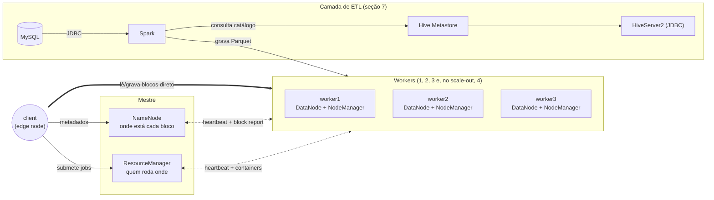

# Hadoop Lab — HDFS + MapReduce + Spark com Docker

Este laboratório sobe um mini cluster Hadoop completo no seu computador, usando Docker, para você experimentar na prática os conceitos vistos em aula: armazenamento distribuído (HDFS), processamento distribuído (MapReduce no YARN e Spark) e catálogo de metadados (Hive Metastore).

A ideia não é virar administrador de cluster nem decorar comandos, e sim **ver funcionando as soluções que o Hadoop trouxe para escalabilidade e tolerância a falhas**. Por isso cada seção começa com uma **Ponte com a aula**, que aponta qual slide aquele passo comprova, e com o conceito antes do comando.

## O que você vai praticar

1. Subir um cluster com um nó mestre e três workers, no mesmo desenho da aula: NameNode e ResourceManager no mestre, DataNode e NodeManager em cada worker.
2. Ver um arquivo virar blocos distribuídos e replicados entre os workers.
3. Derrubar um worker e ver o cluster **detectar** a falha, continuar servindo os dados e **re-replicar** os blocos quando um nó novo entra (scale-out).
4. Derrubar o mestre e entender por que ele é um ponto único de falha.
5. Rodar um word count em MapReduce e comprovar, nos contadores do job, que **o código foi até o dado**.
6. Derrubar um worker no meio de um job e ver as tarefas serem **reexecutadas** em outro nó.
7. Rodar um ETL em Spark (MySQL → Parquet no HDFS → tabela no Hive) e consultá-lo via Spark SQL e JDBC.

## Arquitetura do cluster

As imagens usadas são as oficiais [apache/hadoop](https://hub.docker.com/r/apache/hadoop), [apache/hive](https://hub.docker.com/r/apache/hive) e [apache/spark-py](https://hub.docker.com/r/apache/spark-py). Cada container simula uma máquina diferente de um cluster real:

| Máquina (container) | Processos | Para que serve |
|---|---|---|
| **`namenode`** (mestre do HDFS) | NameNode | Guarda os metadados: a árvore de pastas e arquivos e o mapa de onde está cada bloco. Os dados em si nunca passam por ele. |
| **`resourcemanager`** (mestre do YARN) | ResourceManager | Distribui CPU e memória do cluster (containers) entre os jobs. |
| **`worker1`, `worker2`, `worker3`** | DataNode + NodeManager | Cada worker guarda blocos do HDFS (DataNode) **e** roda tarefas (NodeManager) na mesma máquina. É isso que permite levar o código até o dado. Fator de replicação 3: cada bloco fica copiado em 3 workers diferentes. |
| **`worker4`** | DataNode + NodeManager | Worker extra, só ligado no exercício de scale-out (seção 4.3). |
| **`client`** | nenhum (só o client do Hadoop) | O *edge node*: a máquina de onde você fala com o cluster. Todos os comandos `hdfs`/`yarn`/`hadoop` do lab rodam aqui, fora do mestre e dos workers. |
| **`historyserver`** | JobHistory Server | Guarda o histórico e os contadores dos jobs MapReduce concluídos. |
| **`hive-metastore`** + `hive-metastore-db` | Hive Metastore + Postgres | Catálogo central de tabelas (nome, colunas, schema, localização no HDFS). Tanto o Hive quanto o Spark consultam esse catálogo para saber "o que é a tabela X e onde ela está". Fala Thrift (`9083`), não SQL. |
| **`hiveserver2`** | HiveServer2 | Servidor que executa SQL de fato e expõe uma porta **JDBC** (`10000`) para clients como `beeline` ou DBeaver. Usa o mesmo catálogo do Hive Metastore para saber onde estão os dados. |
| **`spark-master`** + `spark-worker` | Spark | Motor de processamento distribuído, usado aqui para rodar um ETL: MySQL → Parquet no HDFS → tabela no Hive. |
| **`mysql`** | MySQL | Simula um banco transacional de origem (ex.: o banco de um sistema de RH), de onde o ETL extrai os dados. |



## 0. Pré-requisitos e clonagem do repositório

Antes de subir o cluster, confira se a sua máquina atende aos pré-requisitos e baixe o repositório do laboratório.

### 0.1 Pré-requisitos

- **Git**, para clonar o repositório.
- **Docker e Docker Compose**. No Windows e no macOS, o Docker Desktop já instala os dois.
- **Pelo menos 8 GB de memória disponíveis para o Docker** (no Docker Desktop: *Settings → Resources*). Com as seções 1 a 6 no ar, o cluster usa cerca de 5 GB.
- **Portas livres** na sua máquina: `9870`, `8020`, `8088`, `19888`, `8080`, `8081`, `3306`, `9083`, `10000`, `10002`. Algumas portas são as mesmas do lab `modern-data-stack` (por exemplo, `8081` e `8088`): não rode os dois labs ao mesmo tempo.
- **No Windows**, use o PowerShell. Os comandos deste roteiro ficam em uma linha só, para funcionar no PowerShell e no bash. Se preferir o Git Bash, rode antes `export MSYS_NO_PATHCONV=1`. Sem esse comando, o Git Bash converte caminhos como `/user/aluno` em `C:/Program Files/Git/user/aluno`, e os comandos do HDFS falham.

Confira se as ferramentas estão instaladas:

```bash
git --version
docker --version
docker compose version
```

Os três comandos devem mostrar um número de versão. Se algum comando der erro, instale a ferramenta antes de continuar.

### 0.2 Clonar o repositório

```bash
git clone https://github.com/stailer37/impacta-labs.git
cd impacta-labs/hadoop/hadoop_lab
```

Todos os comandos deste laboratório rodam a partir da pasta `hadoop/hadoop_lab`.

Se você já clonou o repositório em outra aula, entre na pasta `impacta-labs` e atualize o repositório com `git pull` em vez de clonar de novo.

Se algo der errado, consulte [TROUBLESHOOTING.md](TROUBLESHOOTING.md).

## 1. Subir o núcleo do cluster: um mestre e três workers

> **Ponte com a aula** — slide "Core Apache Hadoop", na faixa "Visão do cluster": um mestre com NameNode e ResourceManager, e workers com DataNode e NodeManager lado a lado. É exatamente o que você vai subir agora.

Em vez de subir os 14 containers de uma vez, vamos subir o cluster **em camadas**, na ordem em que vamos usá-lo. Primeiro, o núcleo do Hadoop: os dois mestres, três workers e a máquina cliente. Rode o comando na pasta `hadoop/hadoop_lab` (passo 0.2):

```bash
docker compose up -d namenode resourcemanager worker1 worker2 worker3 client
```

**Por que esperar o NameNode ficar "healthy"?** Toda vez que sobe, o NameNode entra em *safe mode*: um estado de só-leitura em que ele aguarda os DataNodes reportarem quais blocos guardam (o *block report*), até ter certeza de que os arquivos estão íntegros. O `healthcheck` do NameNode só fica `healthy` quando o safe mode termina — por isso o ResourceManager e os serviços que gravam no HDFS esperam esse `healthcheck`. Os workers, ao contrário, sobem assim que o NameNode inicia: são eles que tiram o NameNode do safe mode, então não podem esperar por ele.

Acompanhe a inicialização com:

```bash
docker compose ps
```

Quando `namenode` aparecer como `healthy`, confira que os dois mestres enxergam os três workers:

```bash
# o NameNode vê 3 DataNodes vivos?
docker exec client hdfs dfsadmin -report

# o ResourceManager vê 3 NodeManagers?
docker exec client yarn node -list
```

Repare que os nomes se repetem nas duas listas: `worker1`, `worker2`, `worker3`. A mesma máquina guarda blocos e roda tarefas.

> **Por que tudo roda no `client`?** Em um cluster real, ninguém trabalha logado no NameNode: você usa uma máquina cliente, que pede metadados ao mestre e lê e grava os blocos **direto nos workers**. Se os comandos rodassem dentro do container do NameNode, pareceria que os dados passam por ele, e é justamente o contrário do que a aula mostra.

## 2. Acessar as interfaces web

Cada serviço expõe uma UI onde dá para acompanhar visualmente o que está acontecendo — vale a pena deixar aberta enquanto roda os exercícios. Como o ambiente sobe aos poucos, nem todas vão responder agora: use esta tabela como referência e volte a ela conforme for subindo cada camada.

| Interface | URL | O que observar |
|---|---|---|
| NameNode Web UI | http://localhost:9870 | Aba **Datanodes**: os workers `In Service` e a coluna **Last contact**, que é o heartbeat de cada um (fica em poucos segundos enquanto o nó está vivo). Menu **Utilities → Browse the file system**: clique num arquivo para ver os blocos e em quais workers cada um está. |
| ResourceManager Web UI | http://localhost:8088 | Menu **Nodes**: NodeManagers registrados. Página de cada aplicação: tarefas em execução e o nó do ApplicationMaster. |
| JobHistory Web UI | http://localhost:19888 | Jobs MapReduce concluídos: tempo de execução, contadores e em qual worker rodou cada tarefa. |
| Spark Master Web UI | http://localhost:8080 | Workers conectados e aplicações Spark em execução |
| Spark Worker Web UI | http://localhost:8081 | Recursos (CPU/memória) do worker e executors rodando |
| HiveServer2 Web UI | http://localhost:10002 | Sessões e queries SQL em execução/concluídas |

Outros acessos úteis (via linha de comando, não browser):

- HDFS RPC: `hdfs://localhost:8020` — atende só operações de metadados (listar, criar diretório) a partir da sua máquina; ler e gravar conteúdo exige acesso aos DataNodes, que não estão expostos. Isso, aliás, é uma prova do slide "Como os dados são gravados e lidos": o NameNode só dá instruções, os dados nunca passam por ele. Para manipular arquivos, use `docker exec client hdfs dfs ...` como nas seções abaixo.
- MySQL: `localhost:3306`, database `impacta`, usuário `root` / senha `root123`
- Hive Metastore (Thrift): `thrift://localhost:9083`
- HiveServer2 (JDBC): `jdbc:hive2://localhost:10000/default`

## 3. HDFS: um arquivo vira blocos replicados

> **Ponte com a aula** — slides "HDFS: arquivos viram blocos distribuídos" (divisão, distribuição e replicação) e "Como os dados são gravados e lidos" (o cliente fala com o NameNode só para metadados e grava os blocos direto nos DataNodes).

**Conceito:** no HDFS, um arquivo é dividido em blocos, e cada bloco é replicado em vários workers (aqui, fator de replicação 3). O tamanho padrão do bloco é 128 MB, grande demais para um arquivo de laboratório. Por isso vamos gravar com blocos de **1 MB** (`-D dfs.blocksize=1048576`): o mesmo mecanismo, em miniatura.

Primeiro, um arquivo pequeno, só para ver o básico:

```bash
# cria um diretório no HDFS (assim como mkdir, mas no sistema de arquivos distribuído)
docker exec client hdfs dfs -mkdir -p /user/aluno

# grava e lê de volta um arquivo de teste
echo "hello hdfs" | docker exec -i client hdfs dfs -put - /user/aluno/teste.txt
docker exec client hdfs dfs -cat /user/aluno/teste.txt
```

Agora um arquivo de ~10 MB, gerado dentro do `client` e gravado com blocos de 1 MB:

```bash
docker exec client sh -c "seq 1 1500000 > /tmp/numeros.txt && hdfs dfs -D dfs.blocksize=1048576 -put /tmp/numeros.txt /user/aluno/numeros.txt"

# onde foi parar cada bloco?
docker exec client hdfs fsck /user/aluno/numeros.txt -files -blocks -locations
```

**O que observar no `fsck`:**

- A primeira linha diz `11 block(s)`: o arquivo de 10,4 MB foi cortado em 10 blocos de 1 MB e um último de ~0,4 MB.
- Cada bloco aparece com `Live_repl=3` e três `DatanodeInfoWithStorage[...]`, ou seja, as três cópias estão em workers diferentes. O `fsck` mostra os workers pelo IP; para ver os nomes, use a UI (**Utilities → Browse the file system**, clique em `numeros.txt` e escolha um bloco) ou relacione os IPs com a saída de `hdfs dfsadmin -report`.
- No resumo, `Under-replicated blocks: 0`: nenhum bloco está com menos cópias do que deveria. Guarde esse número, ele vai mudar na próxima seção.

**Quanto disco a replicação custa?**

```bash
docker exec client hdfs dfs -du -s -h /user/aluno/numeros.txt
```

A saída tem duas colunas: `10.4 M  31.2 M`. A primeira é o tamanho do arquivo; a segunda, o espaço ocupado no cluster com as 3 réplicas. É a pergunta da aula: 100 TB de cliques com replicação 3 ocupam 300 TB.

> Rodar o `-put` de novo para o mesmo caminho falha com `File exists` — o HDFS não sobrescreve arquivos por padrão. Use `hdfs dfs -put -f` para sobrescrever.

## 4. Tolerância a falhas e scale-out

> **Ponte com a aula** — slide "Sistemas distribuídos sobrevivem a falhas" (detectar, isolar, reexecutar, replicar), o heartbeat do slide "NameNode coordena; DataNodes armazenam" e o slide "Scale-up melhora a máquina; scale-out amplia o cluster". Nesta seção você vê **detectar** e **replicar** acontecendo; o **reexecutar** fica para a seção 6.

Neste lab, um DataNode que para de mandar heartbeat é declarado morto em **~60 segundos**. Em um cluster de produção, o padrão é ~10 minutos: aceleramos no [hadoop.env](hadoop.env) para caber na aula.

### 4.1 Derrubar um worker: os dados continuam lá

```bash
docker stop worker1
docker exec client hdfs dfs -cat /user/aluno/teste.txt
```

O arquivo continua legível: as outras duas réplicas estão em `worker2` e `worker3`. Isso é a **replicação** funcionando.

Talvez apareça um `WARN` com um stack trace longo antes do conteúdo. Não é erro do lab: leia só as linhas de log. Elas contam o que o cliente fez. O NameNode entregou a lista de réplicas, o cliente tentou primeiro a do `worker1` (`Failed to connect to ... add to deadNodes and continue`), desistiu dela e leu de outra (`Successfully connected to ...`).

### 4.2 O NameNode detecta a falha

Logo depois do `stop`, o NameNode ainda acha que o `worker1` está vivo: ele só sabe que algo deu errado quando os heartbeats param de chegar. Abra a aba **Datanodes** em http://localhost:9870 e acompanhe a coluna **Last contact** do `worker1` subindo. Depois de ~1 minuto:

```bash
# quantos DataNodes vivos e mortos?
docker exec client hdfs dfsadmin -report -dead

# e os blocos?
docker exec client hdfs fsck /user/aluno
```

**O que observar:**

- `Dead datanodes (1)`, com o `worker1` e o horário do último heartbeat (`Last contact`). Isso é o **detectar** do slide.
- No `fsck`, `Under-replicated blocks: 12 (100.0 %)` e `Missing replicas: 12 (33.3 %)`: todo bloco perdeu uma das três cópias. Mas `Missing blocks: 0` e `Status: HEALTHY`: nenhum dado foi perdido.
- Por que o NameNode não recria a terceira cópia? Porque só restam 2 workers vivos, e duas réplicas do mesmo bloco nunca ficam no mesmo nó. Falta máquina.

### 4.3 Scale-out: um nó novo entra com o cluster no ar

Em vez de trocar uma máquina por outra maior (scale-up), vamos colocar mais uma ao lado (scale-out), sem parar nada:

```bash
docker compose up -d worker4
```

Espere uns 20 segundos e confira:

```bash
docker exec client hdfs dfsadmin -report
docker exec client hdfs fsck /user/aluno
docker exec client yarn node -list
```

**O que observar:**

- `Live datanodes (3)` de novo, agora com o `worker4`, e o `Configured Capacity` do cluster cresceu.
- `Under-replicated blocks: 0`: assim que o `worker4` entrou, o NameNode mandou copiar para ele as réplicas que faltavam. O cluster se recuperou sozinho: **detectar → replicar**.
- O `worker4` também apareceu como NodeManager no YARN: o nó novo já pode receber tarefas.

> Neste lab todos os workers dividem o mesmo disco do seu computador, então a capacidade "somada" é uma simulação. Em um cluster real, cada máquina nova traz disco, CPU e memória próprios.

### 4.4 O worker antigo volta

```bash
docker start worker1
```

Depois de alguns segundos, rode `docker exec client hdfs fsck /user/aluno` de novo: `Number of data-nodes: 4`, e `Over-replicated blocks: 0`. Por um instante, alguns blocos tiveram 4 cópias (as antigas do `worker1` mais as novas do `worker4`), e o NameNode apagou as excedentes para voltar ao fator 3.

A partir daqui o cluster tem **4 workers**. Ao reiniciar o ambiente, suba o `worker4` junto para manter as 3 cópias de cada bloco (veja "Parar e voltar ao ambiente", no fim).

### 4.5 E se o mestre cair?

Os workers são substituíveis. E o NameNode?

```bash
docker stop namenode
docker exec client hdfs dfs -ls /user/aluno
```

O comando falha: com o NameNode fora, ninguém sabe onde estão os blocos, mesmo com todos os workers de pé e os dados intactos neles. (Aqui o erro é `UnknownHostException: namenode` porque o Docker remove o nome do container parado; em um cluster real seria `Connection refused`.)

```bash
docker start namenode
docker exec client hdfs dfsadmin -safemode get
```

Ao voltar, o NameNode entra em safe mode e só libera escrita depois que os workers reenviam o block report. Repita o `-safemode get` até ver `Safe mode is OFF` (cerca de 30 a 60 segundos). Nos primeiros segundos ele pode responder `Connection refused`, enquanto o processo do NameNode ainda está subindo.

Esse é o **ponto único de falha** que a aula aponta no NameNode e, no Hadoop 1.0, no JobTracker. Em produção a solução é ter um segundo mestre em espera (*standby*), com o ZooKeeper decidindo qual dos dois está ativo. Este lab não monta essa alta disponibilidade, porque o objetivo é ver o problema que ela resolve, não administrá-la.

## 5. MapReduce no YARN: levar o código até o dado

> **Ponte com a aula** — slides "A virada: levar código aos dados", "WordCount: o fluxo de dados", "A cozinha industrial de dados" (o shuffle é a etapa cara) e "Execução: do job ao cluster".

O ResourceManager e os NodeManagers já estão no ar desde a seção 1. Falta só o JobHistory Server, que guarda o histórico dos jobs concluídos:

```bash
docker compose up -d historyserver
```

**Conceito:** o MapReduce processa dados em fases. A fase *Map* lê os dados de entrada e emite pares `(palavra, 1)` para cada ocorrência; a fase *Shuffle/Sort* agrupa e ordena esses pares por chave (palavra), distribuindo-os entre os reducers conforme um hash da chave; a fase *Reduce* soma as ocorrências de cada palavra. O YARN decide em qual worker cada tarefa roda e, sempre que pode, escolhe **o worker que já tem o bloco**.

Para deixar isso visível, a entrada vai ter vários blocos (um map por bloco). Com 3 réplicas em 4 workers, cada bloco está em 3 dos 4: o YARN precisa escolher, para cada map, um worker que tenha aquele bloco. Rodamos com **2 reducers** (`-D mapreduce.job.reduces=2`) para deixar visível que cada reducer processa um subconjunto das palavras e grava seu próprio arquivo de saída:

```bash
# ~10 MB de texto, gravados em blocos de 1 MB
docker exec client sh -c "
  hdfs dfs -mkdir -p /user/aluno/wordcount/input
  yes 'o hadoop leva o codigo ate o dado e o yarn decide onde cada tarefa roda' | head -n 150000 > /tmp/texto.txt
  hdfs dfs -D dfs.blocksize=1048576 -put -f /tmp/texto.txt /user/aluno/wordcount/input/texto.txt
"

# submete o job
docker exec client hadoop jar /opt/hadoop/share/hadoop/mapreduce/hadoop-mapreduce-examples-3.4.2.jar wordcount -D mapreduce.job.reduces=2 /user/aluno/wordcount/input /user/aluno/wordcount/output
```

> Durante o `-put`, pode aparecer um `NotReplicatedYetException ... retries left 4` com stack trace. Com blocos de 1 MB, o cliente pede o bloco seguinte antes de o NameNode registrar o anterior; ele espera um instante e tenta de novo sozinho. O arquivo é gravado normalmente.

Enquanto o job roda, acompanhe em http://localhost:8088. Na página da aplicação, a tabela de *attempts* mostra em qual worker está o **ApplicationMaster**: o gerente daquele job, que pede containers ao ResourceManager e acompanha as tarefas. Cada job tem o seu, e foi essa separação que o YARN trouxe para resolver o gargalo do JobTracker do Hadoop 1.0.

**O que observar nos contadores** (impressos no fim da saída do job, em `Job Counters` e `Map-Reduce Framework`):

| Contador | Valor esperado | O que ele prova |
|---|---|---|
| `Launched map tasks` | `11` | Um map por bloco: os 11 blocos foram processados em paralelo, espalhados pelos workers. |
| `Data-local map tasks` | `11` ou perto disso | Os maps rodaram no worker que tinha o bloco. **O código foi até o dado**, e o dado não atravessou a rede. Se aparecer também `Rack-local map tasks=1`, o worker certo estava ocupado e o YARN preferiu não esperar: aquele map leu o bloco pela rede. |
| `Map output records` | `2400000` | Cada palavra de cada linha virou um par `(palavra, 1)`. |
| `Combine output records` | ~`143` | Antes do shuffle, cada map já somou suas próprias palavras (o *combiner*, um "mini reduce" local). Só ~13 pares por map atravessaram a rede, em vez de 2,4 milhões. |
| `Reduce shuffle bytes` | ~`1.7 KB` | O volume que de fato cruzou a rede no shuffle, a etapa cara da cozinha. |

Agora o resultado:

```bash
# lista os arquivos de saída: um part-r-000XX por reducer
docker exec client hdfs dfs -ls /user/aluno/wordcount/output
docker exec client hdfs dfs -cat /user/aluno/wordcount/output/part-r-00000
docker exec client hdfs dfs -cat /user/aluno/wordcount/output/part-r-00001
```

O resultado esperado é a contagem de cada palavra (`o` 600000 vezes, `hadoop` 150000, etc.), dividida entre `part-r-00000` e `part-r-00001` — cada palavra aparece em um único arquivo, conforme o reducer para o qual foi roteada na fase de Shuffle/Sort.

**Quanto custa distribuir?** Abra o job em http://localhost:19888 e veja o tempo de execução (`Elapsed`): algo como 20 a 40 segundos. Agora conte as palavras do mesmo arquivo numa máquina só:

```bash
docker exec client wc -w /tmp/texto.txt
```

A resposta é instantânea. Para 10 MB, o custo fixo de distribuir (alocar containers, subir JVMs, fazer o shuffle) é muito maior que o trabalho em si. Big Data só se paga em volume: com 100 TB, a conta de "um disco só" leva dias.

> Para rodar o job de novo, apague antes o diretório de saída (`docker exec client hdfs dfs -rm -r /user/aluno/wordcount/output`): o MapReduce se recusa a sobrescrever uma saída existente e falha com `FileAlreadyExistsException`, para não destruir resultados por engano.

## 6. Reexecução: um worker cai no meio do job

> **Ponte com a aula** — o "Reexecutar" do slide "Sistemas distribuídos sobrevivem a falhas" e a pergunta do slide "O YARN resolve o gargalo do Hadoop 1.0": quem descobre que uma tarefa falhou e manda refazê-la? O ApplicationMaster do job.

Para ter tempo de derrubar um worker durante a execução, vamos usar o job `sleep`, que vem nos exemplos do Hadoop: ele não processa dados, só cria tarefas que esperam um tempo fixo. Aqui são 8 maps de 60 segundos cada e 1 reduce. Neste lab, um NodeManager sem heartbeat por 30 segundos é declarado perdido (`LOST`).

Você vai precisar de **dois terminais**.

**Terminal 1** — submete o job e acompanha o progresso:

```bash
docker exec client hadoop jar /opt/hadoop/share/hadoop/mapreduce/hadoop-mapreduce-client-jobclient-3.4.2-tests.jar sleep -m 8 -r 1 -mt 60000 -rt 5000
```

**Terminal 2** — assim que o terminal 1 mostrar `map 0%`, descubra onde as tarefas estão rodando:

```bash
# o host do Tracking-URL é o worker do ApplicationMaster
docker exec client yarn application -list

# quantos containers cada worker está rodando
docker exec client yarn node -list
```

Escolha um worker que tenha containers rodando e **que não seja o do ApplicationMaster**, e derrube-o (troque `worker2` pelo que você escolheu):

```bash
docker stop worker2
```

Depois de ~30 segundos:

```bash
docker exec client yarn node -list -all
```

O worker derrubado aparece como `LOST`. O ApplicationMaster percebe que as tarefas que estavam nele se perderam e pede novos containers para refazê-las em outros workers.

**O que observar no terminal 1:** o job termina com `completed successfully`, e os contadores contam a história:

- `Launched map tasks` maior que 8 (por exemplo, `10`): tarefas foram lançadas de novo.
- `Killed map tasks` igual ao número de tarefas que estavam no worker derrubado (por exemplo, `2`).

Ninguém precisou reenviar o job: o framework detectou a falha e reexecutou só o que se perdeu. Volte o worker para o cluster:

```bash
docker start worker2
```

> **Desafio:** e se você derrubar justamente o worker do ApplicationMaster? Quem cuida do job? Experimente: o ResourceManager percebe que o gerente sumiu e sobe um novo ApplicationMaster em outro worker (na UI 8088, a aplicação passa a ter um segundo *attempt*).

## 7. ETL com Spark e Hive: MySQL → HDFS (Parquet) → Hive

> **Ponte com a aula** — slide "O MapReduce grava em disco a cada etapa": o Spark troca a peça que virou gargalo (o MapReduce) e continua usando o HDFS. Esta seção também antecipa o próximo módulo (Data Lake, Spark e catálogo de tabelas).

Por último, sobe a camada de ETL: o MySQL (fonte de dados), o Hive Metastore (catálogo), o HiveServer2 (consulta SQL/JDBC) e o Spark (Master + Worker):

```bash
docker compose up -d mysql hive-metastore-db hive-metastore hiveserver2 spark-master spark-worker
docker compose ps
```

Espere `mysql`, `hive-metastore-db` e `hive-metastore` ficarem `healthy`/`Up` antes de submeter o job — o `spark-master` já depende deles via `depends_on`, mas, se a máquina estiver lenta, vale conferir com `docker compose ps` antes de seguir.

**Conceito:** este é um pipeline de ETL típico de engenharia de dados — extrai de um banco transacional, transforma/grava em um formato colunar otimizado para analytics (Parquet) e registra a tabela em um catálogo (Hive Metastore) para que outras ferramentas (Spark SQL, BI, etc.) consigam consultá-la sem precisar saber onde o arquivo físico está.

> **Sobre o Spark neste lab:** para economizar memória, o Spark roda no seu próprio gerenciador de cluster (modo *standalone*, com `spark-master` e `spark-worker`), e não sobre o YARN. Em clusters Hadoop de produção é comum o Spark pedir containers ao mesmo ResourceManager que rodou o word count, como a aula mostra. A leitura e a gravação no HDFS são as mesmas nos dois casos.

O MySQL já sobe com uma base `impacta` e uma tabela `employees` de exemplo (veja [mysql/init.sql](mysql/init.sql)). O job [spark/jobs/etl_employees.py](spark/jobs/etl_employees.py) lê essa tabela via JDBC, grava o resultado em Parquet no HDFS e registra a tabela `impacta.employees` no Hive Metastore (`saveAsTable`).

Submeta o job ao cluster Spark:

```bash
docker exec spark-master /opt/spark/bin/spark-submit --master spark://spark-master:7077 /opt/spark/work-dir/jobs/etl_employees.py
```

Agora confira o resultado em cada camada do pipeline:

```bash
# 1) O arquivo Parquet foi realmente gravado no HDFS?
docker exec client hdfs dfs -ls /user/hive/warehouse/impacta.db/employees
```

A camada 2 é o catálogo do Hive Metastore. Abra o `psql` dentro do banco do Hive Metastore:

```bash
# 2) A tabela foi registrada no catálogo do Hive Metastore?
docker exec -it hive-metastore-db psql -U hive -d metastore
```

No prompt `metastore=#`, cole a consulta abaixo e depois saia com `\q`:

```sql
SELECT d."NAME" AS db, t."TBL_NAME" AS table, s."LOCATION" FROM "TBLS" t JOIN "DBS" d ON t."DB_ID" = d."DB_ID" JOIN "SDS" s ON t."SD_ID" = s."SD_ID";
```

```bash
# 3) Dá para consultar a tabela direto pelo Spark, sem tocar no MySQL de novo?
docker exec spark-master /opt/spark/bin/spark-sql --master spark://spark-master:7077 -e "SELECT * FROM impacta.employees LIMIT 5;"
```

O passo 3 é o que demonstra a utilidade do catálogo: o Spark SQL encontrou a tabela `impacta.employees` só pelo nome, sem você precisar informar o caminho do Parquet no HDFS — essa informação já estava no Hive Metastore.

Acompanhe a execução em http://localhost:8080 (Spark Master).

### Consultar a mesma tabela via JDBC (beeline / DBeaver)

**Conceito:** o Hive Metastore (porta `9083`, Thrift) só guarda o catálogo — quem executa SQL de verdade é o **HiveServer2**, que expõe uma porta JDBC (`10000`) e usa o mesmo metastore para descobrir onde os dados estão. É o mesmo papel que um `mysqld` ou `postgres` exerce para seus respectivos drivers JDBC, só que aqui quem responde a consulta é o motor de execução do Hive, lendo o Parquet direto do HDFS.

> **Sobre o motor de execução:** neste lab o HiveServer2 usa o **Tez em modo local** (`hive.execution.engine=tez` + `tez.local.mode=true` no [hive-site.xml](hive/conf/hive-site.xml)), ou seja, as queries rodam dentro do próprio container do HiveServer2, e não como jobs no YARN do cluster — por isso elas não aparecem em http://localhost:8088. Em um cluster de produção o Tez (ou o MapReduce) submeteria cada query ao YARN, igual ao word count da seção 5.

De dentro do container, com o client `beeline` que já vem na imagem:

```bash
docker exec -it hiveserver2 beeline -u jdbc:hive2://hiveserver2:10000/default -n hive -e "SELECT * FROM impacta.employees LIMIT 5;"
```

Um `SELECT * ... LIMIT` simples é respondido lendo o arquivo direto, sem processamento distribuído. Para ver o motor de execução trabalhando de fato, rode uma agregação:

```bash
docker exec -it hiveserver2 beeline -u jdbc:hive2://hiveserver2:10000/default -n hive -e "SELECT department, COUNT(*) AS total, ROUND(AVG(salary), 2) AS avg_salary FROM impacta.employees GROUP BY department ORDER BY department;"
```

O resultado deve bater com a tabela impressa pelo job de ETL do Spark — os dois motores leram os mesmos arquivos Parquet, encontrados pelo mesmo catálogo.

De fora do Docker (DBeaver, IntelliJ, ou qualquer client JDBC genérico), use a URL `jdbc:hive2://localhost:10000/default` com o driver `org.apache.hive:hive-jdbc:3.1.3` — a porta já está publicada no `docker-compose.yml`, então funciona como qualquer outra conexão JDBC.

Acompanhe sessões e queries em execução em http://localhost:10002 (HiveServer2 Web UI).

## Configuração (para quem quiser ir além)

Esta seção é opcional — explica como o cluster é montado por baixo dos panos, caso você queira customizar algo.

- As propriedades de `core-site.xml`, `hdfs-site.xml`, `mapred-site.xml` e `yarn-site.xml` são geradas a partir do [hadoop.env](hadoop.env) pelo próprio entrypoint da imagem (`envtoconf.py`), seguindo o padrão `PREFIXO-SITE.XML_propriedade=valor` (ex.: `YARN-SITE.XML_yarn.resourcemanager.hostname=resourcemanager`).

  > O `$$HADOOP_HOME` em `MAPRED-SITE.XML_*.env` está escapado com `$$` de propósito: o Docker Compose interpola `env_file` antes de repassar as variáveis ao container, então `$$` vira `$HADOOP_HOME` literal — que é resolvido depois pelo próprio YARN ao lançar os containers de map/reduce.

- Cada worker roda dois processos no mesmo container (`hdfs datanode & yarn nodemanager & wait`), como duas daemons na mesma máquina física. O `dumb-init` da imagem repassa o sinal do `docker stop` para os dois.

- Os tempos de detecção de falha foram reduzidos no [hadoop.env](hadoop.env) para caber na aula: DataNode morto após ~60s sem heartbeat (`dfs.heartbeat.interval=3` e `dfs.namenode.heartbeat.recheck-interval=15000`; o tempo é 2 × recheck + 10 × heartbeat) e NodeManager perdido após 30s (`yarn.nm.liveness-monitor.expiry-interval-ms`). Os padrões de produção são ~10 minutos nos dois casos, para não confundir uma rede lenta com uma máquina morta.

- Cada NodeManager oferece 2 GB e 2 vCPUs ao YARN, e cada container de map, reduce ou ApplicationMaster pede 512 MB, para o cluster caber num notebook.

- Os dados de cada nó são persistidos em volumes Docker nomeados, montados em `/data` dentro do container (o NameNode formata o diretório automaticamente na primeira subida, via `ENSURE_NAMENODE_DIR`).

- O **Hive Metastore** (imagem [apache/hive:3.1.3](https://hub.docker.com/r/apache/hive)) usa Postgres como backend e é configurado via [hive/conf/hive-site.xml](hive/conf/hive-site.xml) (montado como `HIVE_CUSTOM_CONF_DIR`). O entrypoint padrão da imagem tenta rodar `schematool -initSchema` toda vez que sobe — em uma reinicialização normal isso quebraria o container, pois o schema já existe. Por isso o serviço usa um wrapper, [hive/init-metastore.sh](hive/init-metastore.sh), que só inicializa o schema na primeira subida (verificando antes com `schematool -info`) e nas demais delega para o entrypoint original com `IS_RESUME=true`.

- O **HiveServer2** usa a mesma imagem e o mesmo [hive/conf/hive-site.xml](hive/conf/hive-site.xml) do Metastore (mesmo `hive.metastore.uris`, mesmo warehouse no HDFS), mas com `SERVICE_NAME=hiveserver2` em vez de `metastore` — por isso não precisa de wrapper próprio: o entrypoint padrão da imagem já sabe iniciar esse serviço sem rodar `schematool`.

- O **Spark** (imagem [apache/spark-py:v3.4.0](https://hub.docker.com/r/apache/spark-py)) é estendido em [spark/Dockerfile](spark/Dockerfile) com o driver JDBC do MySQL e a configuração do Hive (`hive-site.xml` apontando para `thrift://hive-metastore:9083` e `spark-defaults.conf` com `spark.sql.warehouse.dir=hdfs://namenode:8020/user/hive/warehouse`), para que qualquer `spark-submit`/`spark-sql` já saia integrado ao cluster sem flags extras.

## Solução de problemas

Os problemas conhecidos e suas soluções estão em [TROUBLESHOOTING.md](TROUBLESHOOTING.md).

## Parar e voltar ao ambiente

```bash
docker compose down       # mantém os volumes (dados persistem)
docker compose down -v    # remove também os volumes (reset completo)
```

Para voltar depois de um `docker compose down` (sem `-v`), suba o núcleo com **todos os workers que já fizeram parte do cluster**:

```bash
docker compose up -d namenode resourcemanager historyserver worker1 worker2 worker3 worker4 client
```

Se ainda não chegou na seção 4.3, pode deixar o `worker4` de fora. Se já fez o scale-out e esquecer dele, o cluster sobe do mesmo jeito: cada bloco tem 3 cópias, então os outros workers têm pelo menos uma de cada, e o NameNode sai do safe mode. Só que os blocos que tinham cópia no `worker4` ficam sub-replicados (o `fsck` mostra) até ele voltar.

## Encontrou um erro?

Se algum passo deste laboratório não funcionar como descrito (mesmo depois de checar o [TROUBLESHOOTING.md](TROUBLESHOOTING.md)), abra uma issue em [github.com/stailer37/impacta-labs/issues](https://github.com/stailer37/impacta-labs/issues/new). Para facilitar o diagnóstico, inclua:

- O comando exato que você rodou e a saída completa do erro.
- O resultado de `docker compose ps` (mostra o status de cada serviço).
- Os logs do serviço envolvido: `docker compose logs <nome-do-serviço>` (ex.: `docker compose logs namenode`).
- Seu sistema operacional e versão do Docker (`docker --version`, `docker compose version`).
